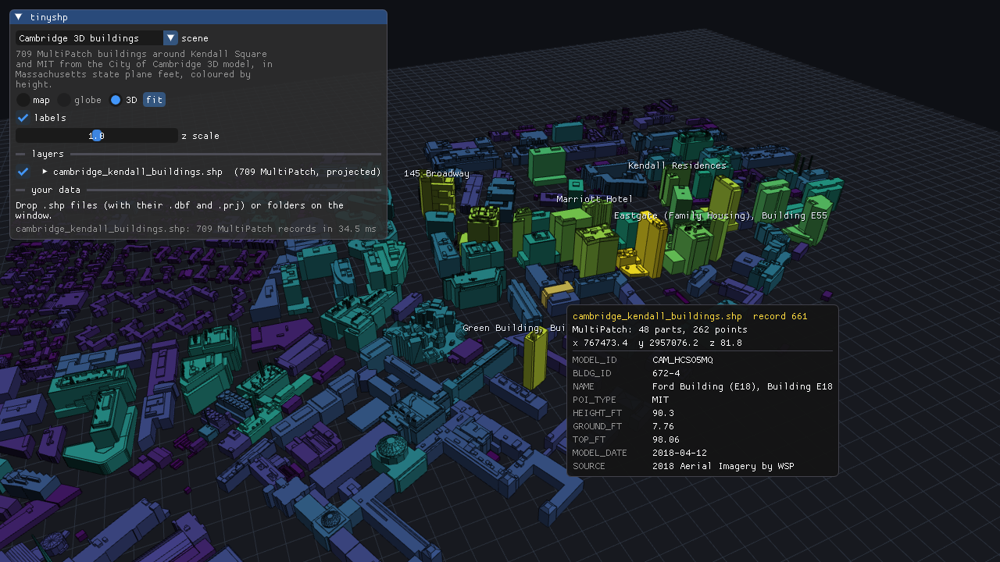
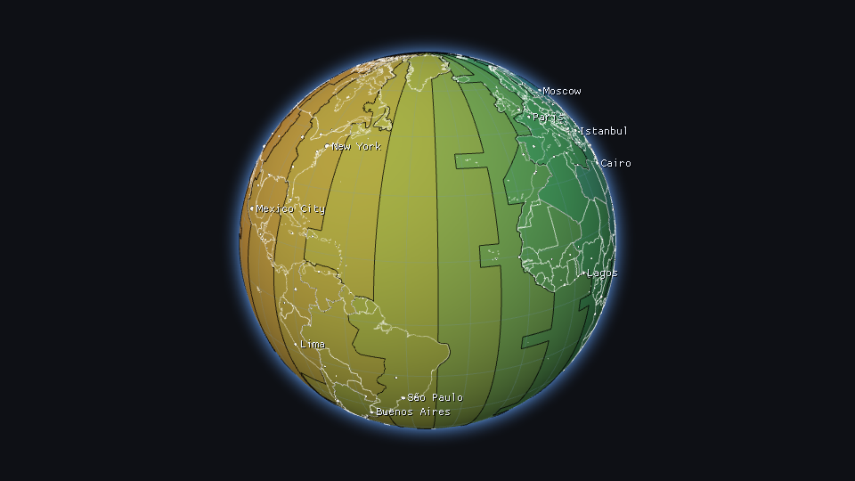
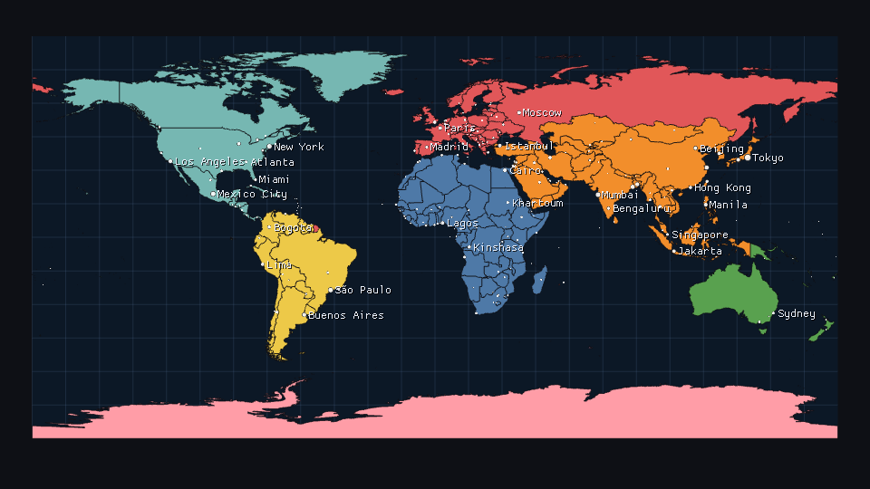
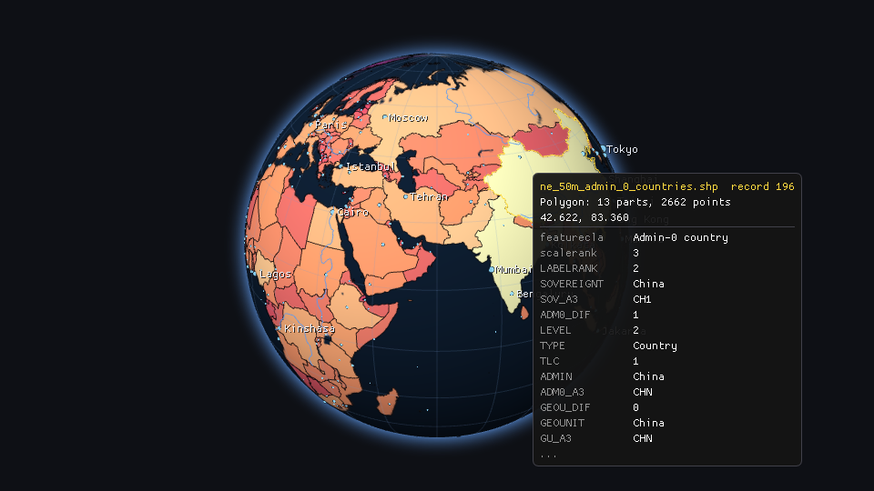

# tinyshp

[](https://github.com/varnholt/tinyshp/actions/workflows/ci.yml)

A loader for ESRI shapefiles in a single C++23 header: geometry from the `.shp` (every shape type, 2D and 3D,
MultiPatch included), attributes from the `.dbf` and the projection from the `.prj`. Plus an OpenGL ES 3 testbed that
shows them on a map, a globe or in 3D, and that also runs in the browser.

**[Live demo](https://varnholt.github.io/tinyshp/)**: the testbed as WebAssembly. Drop your own shapefiles or a `.zip`
on it; they stay in your browser.

[](https://varnholt.github.io/tinyshp/)

- one header, no dependencies beyond the standard library: copy `include/tinyshp/tinyshp.hpp` into your project
- or use it as a CMake library: `add_subdirectory`, `FetchContent` or `find_package`
- loads from files or from memory, e.g. uploads or an archive
- errors come back as `std::expected`, with what went wrong and where; no exceptions, nothing printed
- built for untrusted files: every read is bounds checked, counts are checked against the bytes that are left before
  anything is allocated, and CI runs the tests under address and undefined behavior sanitizers and fuzzes the loader
- `.dbf` text comes back as utf-8, whatever the `.cpg` or the language driver says it was

## Usage

```cpp
#include <tinyshp/tinyshp.hpp>

// countries.shp, plus countries.dbf, .prj and .cpg next to it if they are there
const auto file = tinyshp::loadFile("countries.shp");
if (!file)
{
   std::println("{}", tinyshp::describe(file.error()));  // e.g. "file is truncated at byte 1234: record 17"
   return;
}

const auto& names = *file->_attributes;  // the .dbf: one record per shape
for (std::size_t i = 0; i < file->_shapes.size(); ++i)
{
   const auto& shape = file->_shapes[i];
   for (const auto& polygon : tinyshp::polygons(shape))  // outer rings with their holes
   {
      draw(names.text(i, "NAME"), polygon._outer, polygon._holes);
   }
}
```

From memory, for example files a user uploaded:

```cpp
const auto file = tinyshp::load({._shp = shp_bytes, ._dbf = dbf_bytes, ._prj = prj_text});
```

Hit testing, which handles holes:

```cpp
if (tinyshp::contains(file->_shapes[i], {13.40, 52.52}))  // longitude, latitude
```

### API

Everything lives in namespace `tinyshp`.

| | |
|---|---|
| `loadFile(path, LoadOptions = {})` | reads a `.shp` and the `.dbf`, `.prj` and `.cpg` next to it (either case) |
| `load(std::span<const std::byte> shp, LoadOptions = {})` | parses a `.shp` in memory |
| `load(Sources, LoadOptions = {})` | `.shp`, `.dbf`, `.prj` and `.cpg` in memory, all but the `.shp` optional |
| `loadTable(dbf, LoadOptions = {}, cpg = {})` | just the attribute table |
| `Shapefile` | `_header` (type, bounds, z and m ranges), `_shapes`, `_attributes` (optional), `_projection` (WKT), `isGeographic()` |
| `Shape` | `_type`, `_record_number`, `_bounds`, `_parts`, `_points`, `_z`, `_m`, `_z_range`, `_m_range`, `_part_types` (MultiPatch); `partCount()`, `part(i)`, `isNull()` |
| `Table` | `_fields` (name, type, length, decimals), `_records` (`_deleted`, `_values`); `fieldIndex(name)`, `find`, `text`, `number` |
| `Value` | `std::variant<std::monostate, std::string, double, bool, Date>`; `toString(value)` |
| `polygons(shape)` | outer rings with their holes, by orientation for polygons and by part type for MultiPatch |
| `contains(shape, point)`, `contains(ring, point)` | even-odd point in polygon |
| `signedArea(ring)`, `isClockwise(ring)` | ring orientation; outer rings are clockwise in shapefiles |
| `baseType`, `hasZ`, `mayHaveM`, `isNoData` | shape type helpers; measures below -10^38 are "no data" |
| `LoadOptions` | `_encoding` (`Auto`, `Utf8`, `Windows1252`), `_load_attributes`, `_skip_deleted` |
| `Error` | `_code`, `_offset` in the file, `_detail`; `describe(error)` turns it into a sentence |

## What is supported

| | |
|---|---|
| shape types | Null, Point, MultiPoint, PolyLine, Polygon, their Z and M variants, MultiPatch (triangle strips and fans, outer, inner, first and plain rings) |
| z and m | z for the Z types and MultiPatch; measures where present, including the optional ones of the Z types |
| `.dbf` | dBase III and its FoxPro variants: character, number, float, logical, date, plus binary integer (I) and double (O) fields; deleted records are flagged or skipped |
| text | utf-8 out; in: whatever the `.cpg` names (UTF-8, Windows-1252, ISO-8859-1), else the language driver, else utf-8 where it is valid and Windows-1252 where not |
| `.prj` | kept as text; `isGeographic()` tells longitude and latitude from projected coordinates |

Not supported: the `.shx` index (the `.shp` alone is enough to read every record), spatial indexes (`.sbn`, `.qix`),
memo files (`.dbt`), dBase 7 tables, and reprojection: tinyshp hands you the coordinates the file has.

## Examples

`examples/` has three small tools that also show how to convert shapefiles to more common formats:

```
> shp_info data/cambridge/cambridge_kendall_buildings.shp 1
MultiPatch, 709 records, 4363696 bytes
bounds x 764635.25215514 .. 770087.557851553, y 2955337.7382039726 .. 2959513.765613064
z -3.876829916771385 .. 343.74845908323186
30632 parts, 169597 points, 0 null records
    1906 triangle fan
   28654 outer ring
      72 inner ring
...

> shp2geojson data/naturalearth/ne_110m_lakes.shp lakes.geojson
wrote 24 features to lakes.geojson

> shp2obj data/cambridge/cambridge_kendall_buildings.shp kendall.obj
wrote 709 shapes, 1906 triangles and 28654 polygon faces to kendall.obj
```

- `shp2geojson`: GeoJSON (RFC 7946) with every attribute as a property, z kept, outer rings turned counterclockwise
- `shp2obj`: Wavefront OBJ of the 3D shapes, one object per record, for Blender and friends

## Testbed

 



The testbed draws shapefiles on a flat map, on a globe or, for 3D data, as a lit scene. It comes with a few scenes:

- **Cambridge 3D buildings**: 709 MultiPatch buildings around Kendall Square and MIT from the City of Cambridge's 3D model,
  coloured by height
- **World population**: countries by population on a globe, with lakes, rivers and cities sized by population
- **Time zones**: Natural Earth's 1:10m time zones by UTC offset under the country borders
- **Continents** and **Income groups**: categorical maps

Hover over anything to see its attributes. A Dear ImGui panel colours each layer by a field (categories or a graduated
ramp, optionally on a log scale), sizes points by a field and labels them. Your own files work too: drop `.shp` files,
their folders or, in the browser, a `.zip` on the window. Projected data (UTM, state plane, ...) shows on the map and in
3D; longitude and latitude also on the globe.

Polygons are filled with the stencil buffer (even-odd triangle fans, then their bounding box), so they need no
triangulation and survive the self-intersecting rings real files contain. The globe draws the same fills into a texture
and draws lines and points on top in 3D. MultiPatch faces and PolygonZ rings are triangulated by ear clipping.

```sh
cmake -S . -B build -DTINYSHP_BUILD_TESTBED=ON
cmake --build build --config Release
./build/testbed/tinyshp_testbed                        # the built-in scenes
./build/testbed/tinyshp_testbed roads.shp parcels/     # your files
```

Mouse: drag to pan or rotate, right drag to pan in 3D, wheel to zoom. Keys: 1, 2, 3 map, globe, 3D; F fit; L labels;
Space spin the globe.

Screenshots without a window, optionally with the panel and the tooltip at a pixel:

```sh
./build/testbed/tinyshp_testbed --scene 0 --size 1280x720 --screenshot cambridge.png --mouse 640,360
```

The browser build:

```sh
emcmake cmake -S . -B build-web -DCMAKE_BUILD_TYPE=Release -DTINYSHP_BUILD_TESTBED=ON
cmake --build build-web
python -m http.server -d build-web/testbed
```

## Build

Requirements: CMake 3.25+ and a C++23 compiler. CI builds and tests with MSVC (Visual Studio 2022), GCC 14, Clang 20,
AppleClang (macOS 15) and Emscripten, which also runs the tests under Node.

```
cmake -S . -B build
cmake --build build --config Release
ctest --test-dir build -C Release --output-on-failure
```

| Option | Default | |
|--------|---------|-|
| `TINYSHP_BUILD_TESTS` | top level only | tests against generated files and real Natural Earth and City of Cambridge files |
| `TINYSHP_BUILD_EXAMPLES` | top level only | `shp_info`, `shp2geojson`, `shp2obj` |
| `TINYSHP_BUILD_TESTBED` | `OFF` | the OpenGL ES 3 / WebGL2 viewer; fetches GLFW and Dear ImGui |
| `TINYSHP_BUILD_FUZZER` | `OFF` | libFuzzer target, clang only |
| `TINYSHP_INSTALL` | top level only | install rules and the CMake package |

## Tests

- `tests/tinyshp_test.cpp` builds files with a small writer (`tests/shp_writer.h`) that follows the specification: every
  shape type with and without measures, MultiPatch part types, every dBase field type, encodings, deleted records and
  broken headers, parts and counts, plus every truncation and 3000 random corruptions.
- `tests/reference_test.cpp` loads real files: Natural Earth countries (Lesotho is a hole in South Africa), places,
  rivers, lakes and time zones, and the Cambridge MultiPatch buildings. The expected values were read with GDAL.
- CI runs them under ASan and UBSan, and fuzzes `load()` with libFuzzer for a minute.

## Background

This started in 2014 as a Qt shapefile loader that drew Natural Earth coastlines on a spinning globe. tinyshp is the
rewrite: one header, no Qt, every shape type and the attributes, safe on untrusted input.

The specification: [ESRI Shapefile Technical Description](https://www.esri.com/content/dam/esrisites/sitecore-archive/Files/Pdfs/library/whitepapers/pdfs/shapefile.pdf)
(July 1998).

## License

MIT, see `LICENSE`. The sample data in `data/` is public domain, see `data/README.md`.
